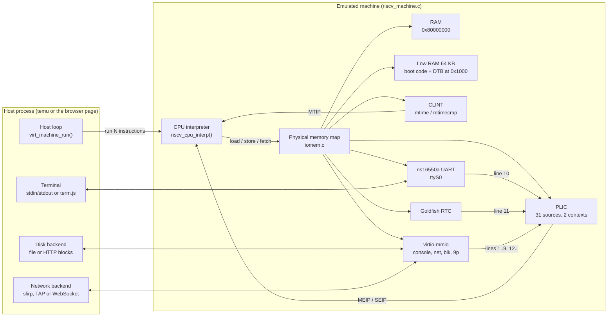

# How TinyVM works: from startup to the main loop

This guide follows TinyVM from the moment you type `temu debian.cfg` until Debian prints
`login:`. It explains the parts that matter for booting Linux: the machine description,
the boot handoff, the main loop, the CPU interpreter, virtio, and the browser build. Every
function and constant named here is in this repository. File names are relative to the
repository root.

TinyVM is TinyEMU 2019-12-21 by Fabrice Bellard plus a set of small fixes (listed in
[section 8](#8-our-patches-and-why-each-was-needed)). Most of the design described here is
his. Where a part was added or changed in this tree, the text says so.

Contents:

1. [The big picture](#1-the-big-picture)
2. [Startup of the native `temu`](#2-startup-of-the-native-temu)
3. [The main loop](#3-the-main-loop)
4. [The CPU interpreter](#4-the-cpu-interpreter)
5. [Virtio](#5-virtio)
6. [Disk and network backends](#6-disk-and-network-backends)
7. [The browser build](#7-the-browser-build)
8. [Our patches and why each was needed](#8-our-patches-and-why-each-was-needed)
9. [Reading the code](#9-reading-the-code)

---

## 1. The big picture

An emulator for a whole computer has to provide four things:

- **A CPU.** Something that reads RISC-V instructions from guest memory and does what they
  say. TinyVM uses a plain interpreter: no JIT, no translation cache. It lives in
  `riscv_cpu.c` and `riscv_cpu_template.h`.
- **A physical address space.** RAM at some addresses, devices at others. A guest load or
  store goes either to a byte array (RAM) or to a C callback (a device register). This is
  `iomem.c`.
- **Devices.** A timer (CLINT), an interrupt controller (PLIC), a serial port (ns16550a
  UART), a real-time clock (Goldfish RTC), and virtio devices for disk, console, network
  and 9p. They are in `riscv_machine.c`, `uart16550.c`, `goldfish_rtc.c` and `virtio.c`.
- **A host loop.** Something that runs the CPU for a while, then waits for host events
  (keyboard, network, timers), and repeats. Native: `virt_machine_run()` in `temu.c`.
  Browser: `virt_machine_run()` in `jsemu.c`.

On top of that comes the software that runs inside: **OpenSBI** (firmware, M-mode), the
**Linux kernel** (S-mode), its **initrd**, and a **root disk image**. TinyVM gives them a
**device tree** (a binary description of the hardware) built in C at startup.



The key idea: the CPU never "knows" about devices. It only knows addresses. The memory map
decides whether an address is RAM or a device. Devices talk back to the CPU only by setting
bits in the `mip` (machine interrupt pending) register.

---

## 2. Startup of the native `temu`

### 2.1 `main()` in `temu.c`

`main()` does the following, in order:

1. **Parse options** with `getopt_long_only()`: `-m <MB>` (RAM size), `-rw`, `-ro`
   (default disk mode, otherwise snapshot), `-ctrlc`, `-append <cmdline>`.
2. **Load the config** with `virt_machine_load_config_file(p, path, NULL, NULL)`
   (`machine.c`). This reads the JSON config and every file it names.
3. **Apply overrides**: `-m` replaces `ram_size`; `-append` goes through `vm_add_cmdline()`,
   which appends to the kernel command line (or replaces it if the argument starts with `!`).
4. **Open the backends**: one `BlockDevice` per `driveN` (`block_device_init()`), one
   `FSDevice` per `fsN` (`fs_disk_init()`, a host directory for 9p), one `EthernetDevice`
   per `ethN` (`slirp_open()` for `driver: "user"`, `tun_open()` for `"tap"`).
5. **Open the console**: `console_init()` puts the host terminal in raw mode and returns a
   `CharacterDevice` with `console_write()` and `console_read()`.
6. **Build the machine**: `virt_machine_init(p)`, which calls `riscv_machine_init()`.
7. **Run forever**: `for(;;) virt_machine_run(s);`

The emulator never returns from step 7. It exits from inside: `C-a x` in `console_read()`,
an HTIF power-off in `htif_handle_cmd()`, or EOF on stdin.

### 2.2 The config file (`machine.c`)

The config is JSON with relaxed syntax (unquoted keys, comments, trailing commas), parsed by
`json.c`. `virt_machine_parse_config()` reads these keys:

| Key | Meaning |
| --- | --- |
| `version` | must be `1` (`VM_CONFIG_VERSION`) |
| `machine` | `"riscv32"`, `"riscv64"` or `"riscv128"`; selects `riscv_machine_class` |
| `memory_size` | RAM in MB (required) |
| `bios` | firmware image, loaded at the start of RAM |
| `kernel` | kernel image, loaded after the firmware |
| `initrd` | initial RAM disk |
| `cmdline` | kernel command line; `${TZ}` is replaced by the host UTC offset (`cmdline_subst()`) |
| `console` | `"virtio"` turns off the UART (hvc0 only); default is the UART |
| `drive0`..`drive3` | `{ file, device, mode }`, `mode` is `"ro"`, `"rw"` or `"snapshot"` |
| `fs0`..`fs3` | `{ file, tag }`, a 9p file system |
| `eth0` | `{ driver: "user" }` or `{ driver: "tap", ifname }` (one interface at most) |
| `display0` | `{ device: "simplefb", width, height }` |
| `input_device` | `"virtio"` adds a virtio keyboard and tablet |

File loading uses callbacks even on the native build. `virt_machine_load_config_file()`
calls `config_load_file()` with `config_file_loaded()` as the callback. That callback parses
the JSON and then walks `files[VM_FILE_BIOS]`, `files[VM_FILE_KERNEL]`,
`files[VM_FILE_INITRD]` one after another through `config_additional_file_load()`. On the
native build `load_file()` reads each file with `fread()` and calls the callback at once.
In the browser the same chain runs over HTTP and each callback fires later (see
[section 7](#7-the-browser-build)). Writing it once in callback style lets both builds share
the code.

Relative file names are resolved against the directory of the config file by
`get_file_path()`.

### 2.3 `riscv_machine_init()`: building the machine

This function in `riscv_machine.c` creates the CPU, the address space and every device.
Here are the addresses, all `#define`s at the top of the file:

```
0x00000000  low RAM, 64 KB (LOW_RAM_SIZE)   boot code at 0x1000, DTB at 0x1040
0x00101000  Goldfish RTC, 0x1000            RTC_BASE_ADDR, PLIC line 11
0x02000000  CLINT, 0xc0000                  CLINT_BASE_ADDR
0x10000000  ns16550a UART, 0x100            UART_BASE_ADDR, PLIC line 10
0x40008000  HTIF, 16 bytes                  HTIF_BASE_ADDR
0x40010000  virtio-mmio #0, #1, ...         VIRTIO_BASE_ADDR + n * 0x1000
0x40100000  PLIC, 0x400000                  PLIC_BASE_ADDR
0x41000000  framebuffer (if display0)       FRAMEBUFFER_BASE_ADDR
0x80000000  RAM, memory_size MB             RAM_BASE_ADDR
```

The UART, RTC and RAM addresses are the same as on QEMU's `virt` machine. That is on purpose:
Linux and OpenSBI already know those devices, and familiar addresses make comparisons
easier.

The steps, in code order:

1. **CPU.** `riscv_cpu_init(s->mem_map, max_xlen)` picks the CPU class for 32, 64 or 128
   bits. Right after, the machine sets `riscv_cpu_time_cb = rtc_get_time`. The CPU calls
   this to read the `time` CSR (see [3.4](#34-time-mtime-and-the-time-csr)).
2. **RAM.** `cpu_register_ram(s->mem_map, RAM_BASE_ADDR, p->ram_size, 0)` and a second,
   64 KB region at address 0. `default_register_ram()` in `iomem.c` simply `mallocz()`s the
   whole size. Guest RAM is one host buffer.
3. **CLINT** with `clint_read`/`clint_write`, **PLIC** with `plic_read`/`plic_write`, and
   31 `IRQSignal`s (`s->plic_irq[1..31]`), each wired to `plic_set_irq()`.
4. **HTIF** (`htif_read`/`htif_write`). HTIF is the old Berkeley host interface. Here it
   is mostly a fallback: `htif_handle_cmd()` prints a byte for "device 1, command 1" and
   exits the emulator when `tohost == 1` (power off).
5. **Goldfish RTC**, `goldfish_rtc_init()`, on PLIC line 11.
6. **UART**, `uart16550_init()`, on PLIC line 10, unless the config says
   `console: "virtio"`. The UART becomes `s->common.console_uart`. It owns the host
   terminal input.
7. **virtio-mmio devices**, in this order: console (if there is a console), network
   (`eth0`), block (`drive0`...), 9p (`fs0`...), then input. Each one takes the next
   0x1000-byte slot starting at `VIRTIO_BASE_ADDR` and the next PLIC line starting at 1.
   `next_free_irq()` skips lines 10 and 11, which belong to the UART and RTC.
8. **Framebuffer**, `simplefb_init()`, if `display0` is set.
9. **`copy_bios()`**: copy the images into RAM and write the device tree and the boot code.

Devices are registered with `cpu_register_device(map, addr, size, opaque, read, write,
flags)`. The flags say which access widths the device accepts (`DEVIO_SIZE8`, `16`, `32`).
There is no 64-bit device callback. A 64-bit load or store to a 32-bit device is split into
two 32-bit calls in `target_read_slow()`/`target_write_slow()` (`riscv_cpu.c`).

How an address is resolved: `get_phys_mem_range()` in `iomem.c` walks a small array of at
most 32 ranges and returns the first that contains the address. The comment says
`XXX: optimize`, and it is a linear search, but it is rarely on the hot path. RAM accesses
normally hit the CPU's soft TLB first (see [4.4](#44-memory-access-and-the-soft-tlb)).

For the demo config (`demo/debian.cfg`: console + `drive0`, no network), the result is:
virtio console at 0x40010000 on line 1, virtio-blk at 0x40011000 on line 2, UART on line 10,
RTC on line 11.

### 2.4 The device tree, built in code

Linux and OpenSBI do not probe for hardware. They read a **flattened device tree** (FDT, the
`.dtb` format) that lists every device, its address and its interrupt line. TinyVM has no
`.dts` file. `riscv_build_fdt()` writes the tree node by node with small helpers:
`fdt_begin_node()`, `fdt_prop_u32()`, `fdt_prop_str()`, `fdt_end_node()`, and
`fdt_output()` serialises it.

The tree it produces:

```
/                       #address-cells = 2, #size-cells = 2
  cpus                  timebase-frequency = 10000000 (RTC_FREQ)
    cpu@0               riscv,isa = "rv64imafdc_zicsr_zifencei", mmu-type = "riscv,sv48"
      interrupt-controller   compatible = "riscv,cpu-intc"  (phandle 1)
  memory@80000000       reg = <RAM_BASE_ADDR, ram_size>
  htif                  compatible = "ucb,htif0", reg = fromhost, tohost
  soc                   compatible = "simple-bus"
    clint@2000000       interrupts-extended = <intc 3>, <intc 7>   (M soft, M timer)
    plic@40100000       riscv,ndev = 31, interrupts-extended = <intc 9>, <intc 11>
                        (S external, M external)  (phandle 2)
    rtc@101000          compatible = "google,goldfish-rtc", interrupt 11
    serial@10000000     compatible = "ns16550a", clock-frequency = 3686400, interrupt 10
    virtio@40010000 ... compatible = "virtio,mmio", one per virtio device
    framebuffer@...     only with display0
  chosen
    bootargs            the kernel command line
    stdout-path         "/soc/serial@10000000"
    linux,initrd-start / linux,initrd-end
    rng-seed            64 bytes from getentropy()
```

A few properties deserve an explanation, because each was a boot blocker:

- **`riscv,isa`**. The upstream code built this string from the `misa` letters in
  alphabetical order, giving something like `rv64acdfimsu`. Linux 6.x expects the
  canonical order and rejects a CPU whose string does not start with `rv64ima`. For 64-bit
  machines the string is now fixed to `rv64imafdc_zicsr_zifencei`.
- **The order of `interrupts-extended` on the PLIC**: S external (9) first, then
  M external (11). PLIC context numbers follow the order of this list. `plic_update_mip()` follows
  it: context 0 drives `SEIP`, context 1 drives `MEIP`.
- **`stdout-path`** points OpenSBI and Linux `earlycon` (with no arguments) at the UART.
  That is why the very first line of firmware output already appears on the terminal.
- **`rng-seed`**. Linux credits this seed to its random number generator. Without it the
  kernel waits for jitter entropy. The commit that added it measured `crng init done` at
  about 101 s before and at 0 s after (see [section 8](#8-our-patches-and-why-each-was-needed)).

**Block order in the blob.** `fdt_output()` writes the header, then the memory reservation
block (8-byte aligned), then the structure block, then the strings block. That is the order
in the Devicetree Specification (section 5.1). It matters because OpenSBI edits the tree
before passing it on: it adds `/reserved-memory` nodes for its own code. libfdt can grow a
blob in place only when the blocks are in that order. With the old order the edit failed
silently, Linux did not know that the start of RAM belonged to the firmware, and it
overwrote OpenSBI. TinyVM has no PMP (physical memory protection), so nothing stopped it.
The symptom was a hang at a different point on every boot.

### 2.5 Where everything goes in memory: `copy_bios()`

`copy_bios()` lays out RAM like this:

```c
/* riscv_machine.c: copy_bios() */
ram_ptr = get_ram_ptr(s, RAM_BASE_ADDR, TRUE);
memcpy(ram_ptr, buf, buf_len);                     /* firmware at 0x80000000 */
...
align = 2 << 20; /* 2 MB page align */
kernel_base = (buf_len + align - 1) & ~(align - 1);
memcpy(ram_ptr + kernel_base, kernel_buf, kernel_buf_len);
...
initrd_base = s->ram_size / 2;
if (initrd_base > (128 << 20))
    initrd_base = 128 << 20;
```

- **Firmware** (`bios`) at `0x80000000`.
- **Kernel** at RAM + the firmware size rounded up to 2 MB. `fw_jump.bin` is about 270 KB,
  so the kernel lands at `0x80200000`. On 32-bit the alignment is 4 MB.
- **Initrd** at RAM + half the RAM size, capped at 128 MB. With 256 MB or more of RAM that is
  `0x88000000`. This is why the README asks for at least 256 MB.
- **Device tree** in low RAM at `0x1040` (`fdt_addr = 0x1000 + 8 * 8`).

The firmware is built to match this layout. `firmware/README.txt` shows the OpenSBI build
flags: `FW_TEXT_START=0x80000000`, `FW_JUMP_ADDR=0x80200000` (where it jumps to the kernel),
`FW_JUMP_FDT_ADDR=0x87e00000` (where it places the device tree for the kernel, just below
the initrd). TinyVM does not tell OpenSBI where the kernel is at run time. The two sides
agree because of these build constants.

### 2.6 The reset vector and the jump to OpenSBI

The CPU starts at `pc = 0x1000` in M-mode (`riscv_cpu_init()` in `riscv_cpu.c`). That address
is in the 64 KB low RAM, and `copy_bios()` writes five instructions there by hand:

```c
/* riscv_machine.c: copy_bios() */
q = (uint32_t *)(ram_ptr + 0x1000);
q[0] = 0x297 + 0x80000000 - 0x1000; /* auipc t0, jump_addr */
q[1] = 0x597; /* auipc a1, dtb */
q[2] = 0x58593 + ((fdt_addr - 4) << 20); /* addi a1, a1, dtb */
q[3] = 0xf1402573; /* csrr a0, mhartid */
q[4] = 0x00028067; /* jalr zero, t0, jump_addr */
```

Read it as assembly:

```
0x1000: auipc t0, 0x7ffff        # t0 = 0x1000 + 0x7ffff000 = 0x80000000
0x1004: auipc a1, 0              # a1 = 0x1004
0x1008: addi  a1, a1, 0x103c     # a1 = 0x1040, the device tree
0x100c: csrr  a0, mhartid        # a0 = 0, the hart id
0x1010: jr    t0                 # jump to the firmware
```

This is the standard RISC-V boot convention: `a0` holds the hart id and `a1` points to the
device tree. Real boards do the same thing in a mask ROM.

From here the guest software takes over:

1. **OpenSBI** (M-mode, `0x80000000`) reads the device tree from `a1`. It finds the UART
   through `stdout-path`, the CLINT for its timer, and the PLIC. It adds its
   `/reserved-memory` nodes, copies the tree to `0x87e00000`, sets up trap delegation
   (`medeleg`, `mideleg`), and drops to S-mode with `mret` at `0x80200000`, again with
   `a0` = hart id and `a1` = device tree.
2. **Linux** (S-mode) boots. It turns on paging by writing `satp`, probes the devices from
   the tree, loads the virtio modules from the initrd, mounts `/dev/vda` and starts systemd.
   From here on, Linux calls OpenSBI with `ecall` for services such as setting the next
   timer interrupt.

On the emulator side the M-to-S switch is `handle_mret()` in `riscv_cpu.c`. It takes the
target privilege from `mstatus.MPP` and jumps to `mepc`. The CPU has no special knowledge
of OpenSBI or Linux.

---

## 3. The main loop

### 3.1 One iteration

`virt_machine_run()` in `temu.c` is one iteration of the host loop. In outline:

```c
/* temu.c: virt_machine_run(), simplified */
delay = virt_machine_get_sleep_duration(m, MAX_SLEEP_TIME);   /* 0..10 ms */

FD_ZERO(&rfds); ...
if (m->console_uart) {
    if (uart16550_get_write_len(m->console_uart) > 0)
        FD_SET(stdin_fd, &rfds);           /* only if the RX FIFO has room */
}
if (m->net)
    m->net->select_fill(m->net, &fd_max, &rfds, &wfds, &efds, &delay);

tv.tv_sec = delay / 1000;
tv.tv_usec = (delay % 1000) * 1000;
ret = select(fd_max + 1, &rfds, &wfds, &efds, &tv);

if (m->net)
    m->net->select_poll(m->net, &rfds, &wfds, &efds, ret);
if (ret > 0 && FD_ISSET(stdin_fd, &rfds)) {
    /* read up to 16 bytes, push them into the UART RX FIFO */
}

virt_machine_interp(m, MAX_EXEC_CYCLE);    /* run up to 500000 instructions */
```

So each turn of the loop does three things:

1. **Decide how long the host may sleep.** If the guest is busy, zero. If the guest is
   idle (it executed `wfi`), until the next timer event, at most 10 ms.
2. **Wait for host events** with `select()`: keyboard input, slirp sockets or a TAP device.
   When the guest is busy the timeout is 0, so `select()` is just a poll.
3. **Run the CPU** for up to `MAX_EXEC_CYCLE` = 500000 instructions.

The constants are `MAX_EXEC_CYCLE 500000` and `MAX_SLEEP_TIME 10` (ms) at the top of
`virt_machine_run()`.

Note the flow control on input. `stdin` is added to the `select()` set only when the UART
has room in its receive FIFO (`uart16550_get_write_len()`). If the guest does not read its
UART, the emulator stops reading the terminal. Nothing is dropped. Keys wait in the host
terminal buffer.

### 3.2 How long to sleep: `riscv_machine_get_sleep_duration()`

```c
/* riscv_machine.c */
static int riscv_machine_get_sleep_duration(VirtMachine *s1, int delay)
{
    ...
    /* RTC alarm */
    delay = goldfish_rtc_poll(m->rtc, delay);

    /* wait for an event: the timer interrupt */
    if (!(riscv_cpu_get_mip(s) & MIP_MTIP)) {
        delay1 = m->timecmp - rtc_get_time(m);
        if (delay1 <= 0) {
            riscv_cpu_set_mip(s, MIP_MTIP);
            delay = 0;
        } else {
            /* convert delay to ms */
            delay1 = delay1 / (RTC_FREQ / 1000);
            if (delay1 < delay)
                delay = delay1;
        }
    }
    if (!riscv_cpu_get_power_down(s))
        delay = 0;
    return delay;
}
```

This function has two jobs, and the second is easy to miss:

- **It computes the sleep time.** It is the smallest of: 10 ms, the time until the Goldfish
  RTC alarm (`goldfish_rtc_poll()`), and the time until `mtime` reaches `mtimecmp`.
- **It fires the timer interrupt.** If `mtime >= mtimecmp`, it sets `MTIP` in `mip` right
  here. There is no separate timer thread. The CLINT timer only "rings" when the main loop
  checks it, once per iteration.

At the end, if the CPU is not powered down (`power_down_flag` is false), the delay is forced
to 0. A busy guest never sleeps.

One consequence: while the guest is busy, the timer interrupt can be late by up to 500000
instructions, because that is how often this check runs. For Linux this is fine. It
programs the timer in absolute time and handles a late tick.

### 3.3 WFI and power down

When Linux has nothing to do, its idle loop executes `wfi` (wait for interrupt). The
interpreter handles it like this:

```c
/* riscv_cpu_template.h, in the SYSTEM opcode (0x73) */
case 0x105: /* wfi */
    ...
    /* go to power down if no enabled interrupts are pending */
    if ((s->mip & s->mie) == 0) {
        s->power_down_flag = TRUE;
        s->pc = GET_PC() + 4;
        goto done_interp;
    }
    break;
```

`riscv_cpu_interp()` (in `riscv_cpu.c`) stops its loop when `power_down_flag` is set. The next
call to `riscv_machine_get_sleep_duration()` sees the flag and returns a real delay, so
`select()` sleeps. The host process uses almost no CPU while the guest is idle.

Waking up goes through `riscv_cpu_set_mip()`:

```c
/* riscv_cpu.c */
s->mip |= mask;
/* exit from power down if an interrupt is pending */
if (s->power_down_flag && (s->mip & s->mie) != 0)
    s->power_down_flag = FALSE;
```

Any device that raises an enabled interrupt clears the flag: the timer check above, a key
pushed into the UART, a network packet, an RTC alarm.

### 3.4 Time: `mtime` and the `time` CSR

There is one clock in the machine, `rtc_get_time()`:

```c
/* riscv_machine.c */
static uint64_t rtc_get_time(RISCVMachine *m)
{
    uint64_t val;
    if (m->rtc_real_time) {
        val = rtc_get_real_time(m) - m->rtc_start_time;
    } else {
        val = riscv_cpu_get_cycles(m->cpu_state) / RTC_FREQ_DIV;
    }
    return val;
}
```

Both `temu.c` and `jsemu.c` set `rtc_real_time = TRUE`, so the clock is the host's
`CLOCK_MONOTONIC` scaled to 10 MHz (`RTC_FREQ`), counted from machine start. The device tree
advertises the same frequency as `timebase-frequency`.

Three things read this clock:

- The CLINT `mtime` register at offset `0xbff8` (`clint_read()`).
- The timer check in `riscv_machine_get_sleep_duration()`, against `mtimecmp`.
- The `time` CSR (`0xc01`), read by the `rdtime` instruction. `csr_read()` in `riscv_cpu.c`
  calls `riscv_cpu_time_cb`, which the machine set to `rtc_get_time`.

Upstream TinyEMU had no `time` CSR. The old BBL firmware trapped `rdtime` and emulated it.
Linux 6.12 and the user-space vDSO (`clock_gettime()`) read `time` directly, so this tree
implements it natively. Because all three readers use one function, `rdtime` and the timer
interrupt can never disagree. Access from S-mode and U-mode is gated by the TM bit (bit 1)
of `mcounteren`/`scounteren`, as the spec requires.

Writing `mtimecmp` (offsets `0x4000`/`0x4004` in `clint_write()`) clears `MTIP`. That is how
firmware acknowledges a timer interrupt: it sets the next deadline.

### 3.5 How interrupts reach the CPU

Every interrupt ends as a bit in `mip`. The bits are defined in `riscv_cpu.h`:
`MIP_MTIP` (7), `MIP_MEIP` (11), `MIP_SEIP` (9), `MIP_STIP` (5), `MIP_SSIP` (1), and others.

**Timer (CLINT).** As shown above, `riscv_machine_get_sleep_duration()` sets `MTIP`.
OpenSBI takes this machine-mode interrupt and passes it to Linux as a supervisor timer
interrupt by setting `STIP`. The CPU allows that: `csr_write()` for `mip` (0x344) accepts
writes to `MIP_SSIP | MIP_STIP`. Linux asks for the next tick with an SBI call (`ecall`),
and OpenSBI writes `mtimecmp`.

**External devices (PLIC).** A device calls `set_irq(irq, level)`. That lands in
`plic_set_irq()`, which updates the pending mask and calls `plic_update_mip()`:

```c
/* riscv_machine.c */
static void plic_update_mip(RISCVMachine *s)
{
    RISCVCPUState *cpu = s->cpu_state;
    if (plic_best_irq(s, 0))
        riscv_cpu_set_mip(cpu, MIP_SEIP);
    else
        riscv_cpu_reset_mip(cpu, MIP_SEIP);
    if (plic_best_irq(s, 1))
        riscv_cpu_set_mip(cpu, MIP_MEIP);
    else
        riscv_cpu_reset_mip(cpu, MIP_MEIP);
}
```

`plic_best_irq(s, ctx)` returns the pending, enabled, not-yet-claimed source with the highest
priority above that context's threshold. Context 0 is S-mode, context 1 is M-mode.

The PLIC protocol, as Linux uses it:

1. The device raises its line. `SEIP` goes up. The CPU traps into Linux.
2. Linux reads the **claim** register (`PLIC_HART_BASE + ctx * 0x1000 + 4`). `plic_read()`
   returns the best source number and marks it "in service" (`plic_served_irq`). An
   in-service source is not offered again.
3. Linux runs the driver. The driver talks to the device, and the device lowers its line.
4. Linux writes the source number to the same register (**complete**). `plic_write()` clears
   the in-service bit, but only if the source is enabled for that context. Linux's
   `plic_irq_eoi()` relies on that rule.

Sources are level-triggered: `plic_pending_irq` mirrors the current device lines. Priorities
are 0..7 (`val & 7`). The upstream PLIC had one claim register, no enables and no
thresholds, and raised `MEIP` and `SEIP` together. This tree implements the PLIC 1.0 register
layout (`PLIC_PRIORITY_BASE`, `PLIC_PENDING_BASE`, `PLIC_ENABLE_BASE`, `PLIC_HART_BASE`).

**Inside the CPU** the interpreter checks `mip & mie` at the start of `riscv_cpu_interp_x64()`
and again at every block boundary (see [4.2](#42-fetch-decode-execute)). If anything is
pending and enabled at the current privilege level, `raise_interrupt()` turns it into a trap.

---

## 4. The CPU interpreter

### 4.1 The XLEN template trick

RISC-V has 32-, 64- and 128-bit variants (XLEN). A 64-bit CPU can also run code in 32-bit mode
when `misa.MXL`, `mstatus.SXL` or `mstatus.UXL` say so. Writing the interpreter three times
would be painful. TinyEMU writes it once and compiles it several times with the C
preprocessor.

There are two levels:

**Level 1: `riscv_cpu.c` is compiled once per `MAX_XLEN`.** `BUILD.bazel` builds it three
times for the native `temu`:

```python
[cc_library(
    name = "riscv_cpu%d" % xlen,
    srcs = ["riscv_cpu.c"],
    local_defines = DEFINES + [
        "MAX_XLEN=%d" % xlen,
        "CONFIG_RISCV_MAX_XLEN=128",
    ],
    ...
) for xlen in [32, 64, 128]]
```

Each copy defines its public names with `glue()` (token pasting, from `cutils.h`). So the
32-bit build exports `riscv_cpu_class32`, the 64-bit build `riscv_cpu_class64`, and so on.
`target_ulong` (the register type) is `uint32_t`, `uint64_t` or `uint128_t` depending on
`MAX_XLEN` (`riscv_cpu_priv.h`). `riscv_cpu_init(mem_map, max_xlen)` picks the class from the
config's `machine` name. The WebAssembly build compiles only `MAX_XLEN=64`.

**Level 2: inside each copy, `riscv_cpu_template.h` is included once per XLEN up to
`MAX_XLEN`.** At the end of `riscv_cpu.c`:

```c
#define XLEN 32
#include "riscv_cpu_template.h"

#if MAX_XLEN >= 64
#define XLEN 64
#include "riscv_cpu_template.h"
#endif
```

Each inclusion defines `riscv_cpu_interp_x32`, `riscv_cpu_interp_x64`, and so on, with
`uintx_t`/`intx_t` set to the right width. `riscv_cpu_interp()` picks one by the current
XLEN:

```c
/* riscv_cpu.c: glue(riscv_cpu_interp, MAX_XLEN) */
timeout = s->insn_counter + n_cycles;
while (!s->power_down_flag &&
       (int)(timeout - s->insn_counter) > 0) {
    n_cycles = timeout - s->insn_counter;
    switch(s->cur_xlen) {
    case 32:
        riscv_cpu_interp_x32(s, n_cycles);
        break;
    case 64:
        riscv_cpu_interp_x64(s, n_cycles);
        break;
    ...
```

This outer `while` is also why `mret`, `sret` and a write to `misa` leave the inner
interpreter with `goto done_interp`: the XLEN may have changed, so the outer loop must pick
the interpreter again.

A "cycle" here is one retired instruction. `insn_counter` counts them, and `mcycle`,
`minstret`, `cycle` and `instret` all read that same counter (`csr_read()`).

### 4.2 Fetch, decode, execute

`riscv_cpu_interp_x64()` is one large function with one `for(;;)` loop and one big `switch`.
The comment in the source explains why: "we use a single execution loop to keep a simple
control flow for emscripten". The same reasoning helps a C compiler too.

**Fetching without a per-instruction lookup.** The loop keeps a host pointer into the
current code page, `code_ptr`, and the end of the safe range, `code_end`. While
`code_ptr < code_end`, fetching is just a 32-bit load from host memory:

```c
/* riscv_cpu_template.h */
} else {
    /* fast path */
    insn = get_insn32(code_ptr);
}
```

When `code_ptr` reaches `code_end` (after a jump, a branch, or at the end of a page), the slow
path runs:

```c
s->pc = GET_PC();
/* we test n_cycles only between blocks so that timer
   interrupts only happen between the blocks. ... */
if (unlikely(s->n_cycles <= 0))
    goto the_end;

/* check pending interrupts */
if (unlikely((s->mip & s->mie) != 0)) {
    if (raise_interrupt(s)) {
        s->n_cycles--;
        goto the_end;
    }
}

addr = s->pc;
tlb_idx = (addr >> PG_SHIFT) & (TLB_SIZE - 1);
if (likely(s->tlb_code[tlb_idx].vaddr == (addr & ~PG_MASK))) {
    ptr = (uint8_t *)(s->tlb_code[tlb_idx].mem_addend + (uintptr_t)addr);
} else {
    if (unlikely(target_read_insn_slow(s, &ptr, addr)))
        goto mmu_exception;
}
code_ptr = ptr;
code_end = ptr + (PG_MASK - 1 - (addr & PG_MASK));
code_to_pc_addend = addr - (uintptr_t)code_ptr;
```

Three ideas are packed in here:

1. **Block boundaries.** The cycle budget and pending interrupts are checked only here, not
   after every instruction. Straight-line code runs with no checks at all. The interrupt
   delay this causes is bounded: every jump, branch taken, trap, or page end returns to this
   path.
2. **The PC is not stored per instruction.** The real PC is computed on demand as
   `code_ptr + code_to_pc_addend` (the `GET_PC()` macro). A non-jump instruction only does
   `code_ptr += 4` (`NEXT_INSN`) or `code_ptr += 2` (`C_NEXT_INSN`).
3. **Page-crossing instructions.** `code_end` stops 2 bytes before the end of the page. A
   32-bit instruction that starts in the last halfword of a page is fetched in two halves,
   the second through `target_read_insn_u16()`, which may fault on the next page.

Jumps use `JUMP_INSN`, which sets `code_ptr = code_end = NULL` and stores the target in
`code_to_pc_addend`. The next turn of the loop sees `code_ptr >= code_end` and takes the slow
path at the new address.

**Decoding** is a `switch` on the low 7 bits:

```c
opcode = insn & 0x7f;
rd = (insn >> 7) & 0x1f;
rs1 = (insn >> 15) & 0x1f;
rs2 = (insn >> 20) & 0x1f;
switch(opcode) {
```

Each case is the full implementation. For example, `jal`:

```c
case 0x6f: /* jal */
    imm = ((insn >> (31 - 20)) & (1 << 20)) |
        ((insn >> (21 - 1)) & 0x7fe) |
        ((insn >> (20 - 11)) & (1 << 11)) |
        (insn & 0xff000);
    imm = (imm << 11) >> 11;
    if (rd != 0)
        s->reg[rd] = GET_PC() + 4;
    s->pc = (intx_t)(GET_PC() + imm);
    JUMP_INSN;
```

Register `x0` is never written. Each case checks `rd != 0`, so `reg[0]` stays zero.

Division follows the RISC-V rules, which differ from C: `div64()` returns -1 for a divide by
zero, and `INT64_MIN / -1` returns `INT64_MIN`, without a trap.

`fence` and `fence.i` decode and do nothing. With one hart and no translation cache there is
nothing to order and no stale translated code to throw away. The interpreter reads
instructions straight from guest RAM every time.

### 4.3 Compressed instructions

The C extension adds 16-bit instructions. Their low two bits are `00`, `01` or `10`. A 32-bit
instruction always ends in `11`. So the same `switch(opcode)` can handle both: the macro
`C_QUADRANT(n)` expands to 32 `case` labels, one for every 7-bit opcode value whose low two
bits are `n`.

```c
#define C_QUADRANT(n) \
    case n+(0 << 2): case n+(1 << 2): case n+(2 << 2): case n+(3 << 2): \
    ...
```

Inside a quadrant, `funct3 = (insn >> 13) & 7` picks the instruction. Immediates are
scattered across the 16 bits, and `get_field1()` (in `riscv_cpu.c`) moves a run of bits
from one position to another. Each compressed case ends with `C_NEXT_INSN`, which advances
`code_ptr` by 2. The fast path still loads 32 bits; the upper half is just ignored.

### 4.4 Memory access and the soft TLB

Every guest load and store goes through `target_read_u8/16/32/64()` and
`target_write_u8/...()`. They are generated by the `TARGET_READ_WRITE` macro in
`riscv_cpu_priv.h`:

```c
static inline __exception int target_read_u ## size(RISCVCPUState *s, uint_type *pval, target_ulong addr)
{
    uint32_t tlb_idx;
    tlb_idx = (addr >> PG_SHIFT) & (TLB_SIZE - 1);
    if (likely(s->tlb_read[tlb_idx].vaddr == (addr & ~(PG_MASK & ~((size / 8) - 1))))) {
        *pval = *(uint_type *)(s->tlb_read[tlb_idx].mem_addend + (uintptr_t)addr);
    } else {
        ...
        ret = target_read_slow(s, &val, addr, size_log2);
```

This is a **soft TLB**: a direct-mapped cache of 256 entries (`TLB_SIZE`) per access type
(`tlb_read`, `tlb_write`, `tlb_code`). An entry maps a guest virtual page to a host pointer
offset (`mem_addend`). A hit costs one compare and one host load.

Two details are worth noticing:

- **The alignment check is free.** The compare keeps the low address bits that must be zero
  for an aligned access of that size. A misaligned address never matches, so it falls
  through to `target_read_slow()`, which splits it into two aligned accesses. Misaligned
  loads and stores therefore work and do not trap.
- **Only RAM is cached.** `target_read_slow()` fills the TLB entry only when the physical
  address is RAM (`pr->is_ram`). Device accesses always take the slow path and call the
  device's `read_func`/`write_func`. That is necessary: a device register must see every
  access.

`tlb_flush_all()` clears every entry. It runs on `sfence.vma`, on a `satp` write, on a
privilege change (`set_priv()`), and when `mstatus` bits that affect translation change
(`MPRV`, `SUM`, `MXR`). `tlb_flush_vaddr()` also flushes everything. That is simple and
correct, if not the fastest.

The write TLB has one more user: dirty tracking for the framebuffer. A write through the fast
path does not set any dirty bit. So when `default_get_dirty_bits()` (`iomem.c`) collects the
dirty pages of the framebuffer, it calls `flush_tlb_write_range()` to drop matching write TLB
entries. The next write to that page takes the slow path, where `phys_mem_set_dirty_bit()`
runs.

### 4.5 Address translation: Sv39 and Sv48

On a TLB miss, `get_phys_addr()` in `riscv_cpu.c` walks the page tables:

```c
/* riscv_cpu.c: get_phys_addr(), 64-bit case */
mode = (s->satp >> 60) & 0xf;
if (mode == 0) {
    /* bare: no translation */
    *ppaddr = vaddr;
    return 0;
} else {
    /* sv39/sv48 */
    levels = mode - 8 + 3;
    pte_size_log2 = 3;
    vaddr_shift = MAX_XLEN - (PG_SHIFT + levels * 9);
    if ((((target_long)vaddr << vaddr_shift) >> vaddr_shift) != vaddr)
        return -1;
    pte_addr_bits = 44;
}
```

`satp` mode 8 is Sv39 (3 levels) and mode 9 is Sv48 (4 levels), so `levels = mode - 8 + 3`.
The check after it rejects virtual addresses that are not properly sign-extended. Then the
loop reads one PTE per level, 9 index bits at a time:

- `V` clear: page fault.
- `R`, `W`, `X` all zero: pointer to the next level.
- Otherwise a leaf. Check `U` against the privilege (`SUM` lets S-mode touch user pages),
  apply `MXR`, and check the access type against `R`/`W`/`X`.
- Set the `A` (accessed) bit, and `D` (dirty) on a write, writing the PTE back if it
  changed. The emulator does this in "hardware"; the guest kernel does not need to handle a
  fault for it.
- For a superpage leaf at a higher level, the low bits come from the virtual address
  (`vaddr_mask`).

The `satp` write in `csr_write()` only accepts modes 0, 8 and 9. Any other mode leaves the old
one in place. A kernel that tries a larger mode (Sv57) and reads `satp` back sees that it did
not stick. The device tree advertises `mmu-type = "riscv,sv48"`. ASIDs are not implemented
(the comment says `no ASID implemented`).

In M-mode there is no translation, unless `mstatus.MPRV` is set for a data access; then the
privilege in `MPP` is used. OpenSBI uses this to read S-mode memory.

When translation fails, the slow path stores the cause (`CAUSE_LOAD_PAGE_FAULT`, and so on)
in `s->pending_exception` and the address in `pending_tval`, and the instruction does
`goto mmu_exception`.

### 4.6 Privilege modes, traps and interrupts

The CPU has three privilege levels in `s->priv`: `PRV_U` (0), `PRV_S` (1), `PRV_M` (3). There is
no hypervisor mode.

All exceptions end in `raise_exception2()`:

```c
/* riscv_cpu.c: raise_exception2() */
if (s->priv <= PRV_S) {
    /* delegate the exception to the supervisor priviledge */
    if (cause & CAUSE_INTERRUPT)
        deleg = (s->mideleg >> (cause & (MAX_XLEN - 1))) & 1;
    else
        deleg = (s->medeleg >> cause) & 1;
} else {
    deleg = 0;
}
```

This is the delegation rule: a trap from U- or S-mode goes to S-mode if the matching bit in
`medeleg` (exceptions) or `mideleg` (interrupts) is set; everything else goes to M-mode. Then
it saves the state the spec asks for: `sepc`/`mepc` = the faulting PC, `scause`/`mcause`,
`stval`/`mtval`, and in `mstatus` the previous interrupt enable (`SPIE`/`MPIE`) and previous
privilege (`SPP`/`MPP`). It clears `SIE`/`MIE` and jumps to `stvec`/`mtvec`. Vectored mode is
not supported: `csr_write()` stores `stvec` and `mtvec` with the low two bits cleared.

`ecall` sets `pending_exception = CAUSE_USER_ECALL + s->priv`, so the cause tells the handler
which mode called. That is how a Linux SBI call (from S-mode, cause 9) reaches OpenSBI.

`sret` and `mret` are the reverse: `handle_sret()` and `handle_mret()` restore the enable bit
from `SPIE`/`MPIE`, switch to the privilege saved in `SPP`/`MPP`, and jump to `sepc`/`mepc`.

Which interrupt is taken is decided in `get_pending_irq_mask()`:

```c
/* riscv_cpu.c */
pending_ints = s->mip & s->mie;
...
switch(s->priv) {
case PRV_M:
    if (s->mstatus & MSTATUS_MIE)
        enabled_ints = ~s->mideleg;
    break;
case PRV_S:
    enabled_ints = ~s->mideleg;
    if (s->mstatus & MSTATUS_SIE)
        enabled_ints |= s->mideleg;
    break;
default:
case PRV_U:
    enabled_ints = -1;
    break;
}
```

In words: M-mode interrupts always preempt S- and U-mode. S-mode interrupts are taken in
S-mode only if `SIE` is set, and always in U-mode. `raise_interrupt()` then takes the lowest
set bit (`ctz32(mask)`). Note that this is a simpler order than the priority order in the
privileged spec; with one hart and Linux's usual settings it does not get in the way.

Illegal instructions set `pending_exception = CAUSE_ILLEGAL_INSTRUCTION` and
`pending_tval = insn` (the instruction bits), at the `illegal_insn:` label near the end of the
interpreter.

### 4.7 CSRs

`csr_read()` and `csr_write()` in `riscv_cpu.c` are large `switch` statements on the 12-bit CSR
number. Two generic checks come first in `csr_read()`:

```c
if (((csr & 0xc00) == 0xc00) && will_write)
    return -1; /* read-only CSR */
if (s->priv < ((csr >> 8) & 3))
    return -1; /* not enough priviledge */
```

The CSR number itself encodes "read-only" (top two bits `11`) and the lowest privilege
allowed (bits 9:8). A return of -1 becomes an illegal-instruction trap.

Some details that matter for booting:

- `sstatus`, `sie` and `sip` are not separate registers. They are masked views of `mstatus`,
  `mie` and `mip` (`SSTATUS_MASK`, and `mideleg` as the mask for `sie`/`sip`).
- `mstatus.FS` is kept apart in `s->fs`, and `get_mstatus()` computes the `SD` bit.
- Writable fields are masked on write (WARL behaviour): `medeleg`, `mideleg`, `mie`, `mip`,
  `mcounteren`, `satp` all keep only the bits the CPU supports.
- `mvendorid`, `marchid`, `mimpid` and `mconfigptr` read as 0. They were missing upstream,
  and OpenSBI stopped with "Failed to access CSR 0xf11".
- `csr_write()` returns 2 when TLBs were flushed (`satp`) and 1 when the XLEN changed
  (`misa`). The instruction then restarts fetching (`JUMP_INSN`) or leaves the interpreter
  (`done_interp`), because the cached `code_ptr` may no longer be valid.

Before reading a counter CSR, the `csrrw`/`csrrs` cases store `s->insn_counter =
GET_INSN_COUNTER()`, so `cycle` and `instret` are exact even in the middle of a block.

### 4.8 Floating point via softfp

The F and D extensions (and Q on the 128-bit build) are implemented without the host FPU.
`softfp.c` includes `softfp_template.h` once per float size and provides `add_sf32`,
`mul_sf64`, `sqrt_sf64`, conversions, comparisons and `fclass`. Each takes a rounding mode
and a pointer to the `fflags` accumulator:

```c
/* riscv_cpu_fp_template.h */
case (0x00 << 2) | OPID:
    rm = get_insn_rm(s, rm);
    if (rm < 0)
        goto illegal_insn;
    s->fp_reg[rd] = glue(add_sf, F_SIZE)(s->fp_reg[rs1],
                             s->fp_reg[rs2],
                             rm, &s->fflags) | F_HIGH;
    s->fs = 3;
    break;
```

Why software and not host `double`? RISC-V defines the exact result, the rounding mode per
instruction (`rm`, or the dynamic `frm` when `rm == 7`), the exception flags, and the
canonical NaN. Host FPUs and C compilers do not give that control portably, and in
WebAssembly there is no way to set the rounding mode at all. Software gives the same bits on
every host.

`F_HIGH` implements NaN boxing: a 32-bit float stored in a 64-bit register has its upper 32
bits set to all ones. `s->fs = 3` marks the FP state dirty, which Linux uses to decide whether
to save FP registers on a context switch. If `fs` is 0 (FP off), every FP instruction and FP
CSR access is illegal; this is how Linux turns the FPU off for tasks that do not use it.

---

## 5. Virtio

### 5.1 Why virtio

Emulating a real disk controller means emulating its quirks. Virtio is a device standard
designed for virtual machines. The guest puts requests in shared memory and rings a
doorbell; the device processes them and raises an interrupt. Linux has drivers for
`virtio-blk`, `virtio-net`, `virtio-console` and `9p` over virtio, and the Debian kernel loads
them from the initrd.

TinyVM uses the **virtio-mmio** transport: each device is a 4 KB register window. The
device tree has one `virtio,mmio` node per device. (`virtio.c` also has a PCI transport,
which the RISC-V machine does not use.)

### 5.2 The MMIO registers

`virtio_mmio_read()` and `virtio_mmio_write()` in `virtio.c` handle the window. The important
registers:

| Offset | Name | Behaviour in TinyVM |
| --- | --- | --- |
| 0x000 | MagicValue | reads `0x74726976` ("virt") |
| 0x004 | Version | reads 2 (modern virtio-mmio) |
| 0x008 | DeviceID | 1 net, 2 block, 3 console, 9 9p, 18 input |
| 0x010 | DeviceFeatures | low word: device features; word 1 reads 1 (`VIRTIO_F_VERSION_1`) |
| 0x030 | QueueSel | selects the queue the next registers refer to |
| 0x034 | QueueNumMax | reads `MAX_QUEUE_NUM` = 256 |
| 0x038 | QueueNum | accepted if a power of two and at most 256 |
| 0x044 | QueueReady | 1 = queue is live |
| 0x050 | QueueNotify | the doorbell: calls `queue_notify()` |
| 0x060 | InterruptStatus | bit 0 = used buffer notification |
| 0x064 | InterruptAck | clears bits; lowers the IRQ line when none are left |
| 0x070 | Status | driver status; writing 0 resets the device |
| 0x080..0x0a4 | QueueDesc/Avail/Used Low/High | guest physical addresses of the three rings |
| 0x100.. | Config | device-specific config space |

Driver feature writes are not stored. The device offers a fixed set and assumes the driver
accepted it.

### 5.3 Virtqueues: descriptors, available ring, used ring

A virtqueue is three arrays in guest RAM. The driver allocates them and writes their
addresses into the registers above.

```
Descriptor table (desc_addr)      Available ring (avail_addr)    Used ring (used_addr)
  [i] addr  len  flags  next        flags                          flags
      ...                           idx  <- driver increments      idx  <- device increments
                                    ring[num] = head desc index    ring[num] = { id, len }
```

- A **descriptor** (`VIRTIODesc`) is `{ addr, len, flags, next }`, a pointer to one buffer in
  guest memory. `VRING_DESC_F_NEXT` chains descriptors. `VRING_DESC_F_WRITE` marks buffers
  the device writes into (for example, the data of a disk read). In a chain, all readable
  buffers come before all writable ones.
- The **available ring** is where the driver publishes the head of each new chain, then
  increments `avail->idx`.
- The **used ring** is where the device returns finished chains with the number of bytes it
  wrote, then increments `used->idx`.

`QueueState` keeps the device side: the three addresses, `num`, and `last_avail_idx`, the
next available entry the device has not looked at yet.

### 5.4 A block read, from start to finish

Here is what happens when Linux reads a sector from `/dev/vda`, with `drive0` backed by a
host file:

1. **Driver builds a chain.** Linux writes a 16-byte request header (`BlockRequestHeader`:
   `type = VIRTIO_BLK_T_IN`, `sector_num`), a writable data buffer, and a writable one-byte
   status. It puts the head index in the available ring and increments `avail->idx`.
2. **Driver rings the doorbell.** A 32-bit store of the queue number (0) to `QueueNotify`.
   The CPU's store goes through `target_write_slow()` to `virtio_mmio_write()`, which calls
   `queue_notify(s, 0)`.
3. **Device walks the ring.** `queue_notify()` reads `avail->idx`. For each new entry it
   finds the head descriptor and calls `get_desc_rw_size()`, which adds up the readable and
   writable lengths of the chain. Then it calls the device's `device_recv` callback,
   `virtio_block_recv_request()`.
4. **Device decodes the request.** `virtio_block_recv_request()` copies the header out of the
   chain with `memcpy_from_queue()`. For `VIRTIO_BLK_T_IN` it allocates `write_size` bytes and
   calls the backend: `bs->read_async(bs, h.sector_num, buf, (write_size - 1) / SECTOR_SIZE,
   virtio_block_req_cb, s)`. The `- 1` is the status byte.
5. **Backend reads.** For a file, `bf_read_async()` in `temu.c` does `fseek()` + `fread()` and
   returns 0 ("done, synchronously").
6. **Device completes.** Because the return was not positive, `virtio_block_req_end()` runs at
   once. It writes the status byte (`VIRTIO_BLK_S_OK`) as the last byte of the buffer, copies
   the whole buffer into the writable descriptors with `memcpy_to_queue()`, and calls
   `virtio_consume_desc()`:

   ```c
   /* virtio.c: virtio_consume_desc() */
   addr = qs->used_addr + 2;
   index = virtio_read16(s, addr);
   virtio_write16(s, addr, index + 1);

   addr = qs->used_addr + 4 + (index & (qs->num - 1)) * 8;
   virtio_write32(s, addr, desc_idx);
   virtio_write32(s, addr + 4, desc_len);

   s->int_status |= 1;
   set_irq(s->irq, 1);
   ```

7. **Interrupt.** `set_irq()` raises the device's PLIC line. `plic_set_irq()` →
   `plic_update_mip()` → `riscv_cpu_set_mip(MIP_SEIP)`.
8. **Guest handles it.** At the next block boundary the CPU traps to Linux. Linux claims the
   source at the PLIC, reads `InterruptStatus`, writes `InterruptAck` (the device lowers its
   line), reads the used ring, and completes the I/O. Then it writes the PLIC complete
   register.

With the native file backend, steps 2 to 7 all happen inside the guest's single store to
`QueueNotify`. The disk is "infinitely fast" from the guest's point of view.

If the backend is asynchronous (the HTTP disk in [6.2](#62-the-http-block-device-block_netc)),
`read_async()` returns 1. The device sets `req_in_progress` and returns. While a request is in
progress, `virtio_block_recv_request()` returns -1 for new requests, which makes
`queue_notify()` stop and leave them in the ring. When the data arrives, the backend calls
`virtio_block_req_cb()`, which completes the request and calls `queue_notify()` again to pick
up the next one. One request is in flight at a time.

Other request types:

- `VIRTIO_BLK_T_OUT` (write): refused with `VIRTIO_BLK_S_IOERR` if the drive is read-only,
  otherwise passed to `bs->write_async()`.
- `VIRTIO_BLK_T_FLUSH`: calls `bs->flush()`. For a `rw` file that is `fflush()` + `fsync()`
  (`bf_flush()` in `temu.c`).
- Anything else (for example `VIRTIO_BLK_T_GET_ID`): completed with `VIRTIO_BLK_S_UNSUPP`.
  The device must complete every request; a request that is never returned makes the guest
  wait forever.

`virtio_block_init()` offers `VIRTIO_BLK_F_FLUSH` always and `VIRTIO_BLK_F_RO` for read-only
drives, and puts the disk size in sectors in the config space.

All guest memory accesses from devices go through `virtio_memcpy_from_ram()` and
`virtio_memcpy_to_ram()`, page by page, using `phys_mem_get_ram_ptr()`. Devices copy directly
to and from the host RAM buffer. The `is_rw` flag marks written pages dirty.

### 5.5 Console and network, briefly

**virtio-console** (device 3) has two queues. Queue 1 is guest output:
`virtio_console_recv_request()` copies the buffer out and calls `cs->write_data()` (stdout).
Queue 0 is input, and it is marked `manual_recv`: the device does not process it on notify.
Instead the host fills it when it has data, through `virtio_console_write_data()`. In this
tree the UART owns the terminal input, so the virtio console only receives input when the
config says `console: "virtio"`. Its output (hvc0) still reaches the terminal.

**virtio-net** (device 1) follows the same pattern. Queue 1 (TX) is processed on notify:
`virtio_net_recv_request()` strips the `VIRTIONetHeader` and calls `es->write_packet()`, which
hands the Ethernet frame to slirp, TAP or the browser. Queue 0 (RX) is `manual_recv`: when
the backend has a frame, it calls `virtio_net_write_packet()`, which takes the next available
buffer, writes a zero header plus the frame, and consumes the descriptor. The backend first
asks `virtio_net_can_write_packet()` whether the guest has posted any RX buffer.

### 5.6 Why 256-entry queues

Upstream TinyEMU had `MAX_QUEUE_NUM 16`. Linux 6.12's virtio-net stops its TX queue when
fewer than `2 + MAX_SKB_FRAGS` (19) descriptors are free, in `check_sq_full_and_disable()`.
With a 16-entry ring that condition is always true. The queue stopped after the first packet,
and the kernel logged "NETDEV WATCHDOG: transmit queue 0 timed out" every few seconds. The fix
raises the maximum to 256 (a power of two) and accepts any power-of-two `QueueNum` up to that.
The ring code already used `qs->num - 1` as a mask, so nothing else had to change.

---

## 6. Disk and network backends

Devices and backends are separated by small interfaces in `virtio.h`. `BlockDevice` has
`get_sector_count`, `read_async`, `write_async`, `read_only` and `flush`. `EthernetDevice` has
`write_packet` (guest to host) and, set by the device, `device_write_packet` (host to guest).
`CharacterDevice` has `write_data` and `read_data`. The virtio code does not know whether the
disk is a file or a set of HTTP blobs.

### 6.1 The file block device (`temu.c`)

`block_device_init()` in `temu.c` opens the image and supports three modes
(`BlockDeviceModeEnum`):

- **`ro`**: writes fail; the device advertises `VIRTIO_BLK_F_RO`, so Linux marks the disk
  read-only.
- **`rw`**: reads and writes go straight to the file with `fseek()`/`fread()`/`fwrite()`.
- **`snapshot`** (the default): reads come from the file, writes go to a table of 512-byte
  sectors in memory (`sector_table`). A later read of a written sector returns the memory
  copy. The file never changes, and all writes are lost on exit.

All three are synchronous: `bf_read_async()` and `bf_write_async()` return 0.

`fs_disk.c` is something else: it is the backend for a **9p file system** (`fs0`), which
exports a host directory to the guest through `virtio_9p_init()`. Linux mounts it with the
`9p` file system type. The Debian demo does not use it.

### 6.2 The HTTP block device (`block_net.c`)

The browser cannot open a 2 GB file. So the disk is cut into fixed-size blocks, each its own
file on a web server. The `splitimg` tool does the cutting:

```sh
bazel-bin/splitimg root.img root 256     # root/blk.txt + root/blk000000000.bin ...
```

`blk.txt` is a small JSON file written by `splitimg.c`:

```
{
  block_size: 256,
  n_block: <count>,
}
```

`block_size` is in KB. `block_device_init_http()` fetches `blk.txt` and parses it in
`bf_init_onload()`, then calls the start callback. From then on:

- A read is split by block. If the block is in the cache (`bf_find_block()`), it is copied out.
  If not, `bf_start_load_block()` fetches `blkNNNNNNNNN.bin` (`BLK_FMT`), and `bf_rw_async1()`
  returns 1, meaning "asynchronous, wait". When the block arrives, `bf_update_block()`
  resumes the request, and at the end `bf->cb()` completes the virtio request.
- The cache is a list in most-recently-used order. `bf_find_block()` moves a hit to the front;
  `bf_add_block()` evicts loaded blocks from the back when the cache is full. The size limit
  is `max_cache_size_kb`; `jsemu.c` passes 131072 (128 MB).
- **Writes stay in memory.** The first write to a 4 KB cluster (`sectors_per_cluster = 8`)
  copies that part of the cached block into a new `Cluster`, and later reads and writes of
  that cluster use the copy. Nothing is sent back to the server. A page reload starts from
  the original image.
- `blk.txt` may also list `prefetch` blocks (and `prefetch_group_len` for grouped files),
  loaded at start.

Blocks are held in `FileBuffer`s. In the browser, `js/lib.js` keeps their contents in
JavaScript `Uint8Array`s (`file_buffer_resize()`, `file_buffer_read()`,
`file_buffer_write()`) instead of the WebAssembly heap.

The native `temu` from Bazel does not include this backend; it is part of the WebAssembly
build. (The upstream `Makefile` can build a native `temu` with it, using libcurl, under
`CONFIG_FS_NET`.)

### 6.3 Networking: slirp

`eth0: { driver: "user" }` uses **slirp**, a user-mode TCP/IP stack (the `slirp/` directory;
the file headers credit Fabrice Bellard and QEMU). The guest sends raw Ethernet frames. slirp answers ARP itself,
runs a DHCP server, and turns guest TCP connections and UDP packets into ordinary host
sockets. No root rights and no host network setup are needed.

The addresses come from `slirp_open()` in `temu.c`:

```c
struct in_addr net_addr  = { .s_addr = htonl(0x0a000200) }; /* 10.0.2.0 */
struct in_addr mask = { .s_addr = htonl(0xffffff00) }; /* 255.255.255.0 */
struct in_addr host = { .s_addr = htonl(0x0a000202) }; /* 10.0.2.2 */
struct in_addr dhcp = { .s_addr = htonl(0x0a00020f) }; /* 10.0.2.15 */
struct in_addr dns  = { .s_addr = htonl(0x0a000203) }; /* 10.0.2.3 */
```

The guest gets 10.0.2.15 by DHCP, the gateway is 10.0.2.2, and DNS goes to 10.0.2.3.

slirp joins the main loop through the two `EthernetDevice` hooks:
`slirp_select_fill1()` adds slirp's sockets to the `select()` sets, and `slirp_select_poll1()`
lets slirp process whatever became ready. Frames to the guest go
`slirp_output()` → `net->device_write_packet()` → `virtio_net_write_packet()`. slirp asks
`slirp_can_output()` first (in `if_start()` in `slirp/if.c`), so it holds packets while the
guest has no free RX buffers.

The alternative, `driver: "tap"`, opens a Linux TAP interface (`tun_open()`). It is not
available on macOS.

---

## 7. The browser build

### 7.1 What is different

The browser build is the same C code compiled to WebAssembly with emscripten. The Bazel
target `//:tinyvm_wasm_bin` uses `jsemu.c` instead of `temu.c`, adds `block_net.c`,
`fs_net.c` and `fs_wget.c`, and defines `MAX_XLEN=64`, `CONFIG_FS_NET` and `EMSCRIPTEN=1`.
`js/lib.js` provides the C functions that must be written in JavaScript: terminal output,
HTTP requests, file buffers, framebuffer drawing, network frames.

Emscripten flags worth knowing (`BUILD.bazel`): `-sALLOW_MEMORY_GROWTH=1` and
`-sMAXIMUM_MEMORY=4GB`, because the guest RAM is a `mallocz()` in the WebAssembly heap;
`-sFILESYSTEM=0`, because all files come over HTTP.

Two CPU options change under emscripten (`riscv_cpu_priv.h`): `USE_GLOBAL_STATE` (one static
`RISCVCPUState`) and `USE_GLOBAL_VARIABLES` (`code_ptr` and friends live in the state struct).
The comment in the source says that local variables slow down the generated JS code.

### 7.2 Starting: async all the way

The page cannot block while it waits for files. So startup is a chain of callbacks:

1. `demo/jslinux.js` loads `riscvemu64-wasm.js`, waits for `Module.onRuntimeInitialized`,
   and calls the exported C function `vm_start(url, mem_size, cmdline, pwd, width, height,
   has_network)` through `Module.ccall()`.
2. `vm_start()` in `jsemu.c` calls `virt_machine_load_config_file(s->p, url, init_vm_fs, s)`.
   The config URL is absolute, so `config_load_file()` takes the `is_url()` branch and uses
   `fs_wget()`. That ends in `emscripten_async_wget3_data()` in `js/lib.js`, an
   `XMLHttpRequest` with `responseType = 'arraybuffer'`. When it finishes, the bytes are copied
   into the WebAssembly heap and the C callback is called through `getWasmTableEntry()`.
3. The same chain as native ([2.2](#22-the-config-file-machinec)) loads the bios, kernel and
   initrd, one request after another, then calls `init_vm_fs()`.
4. `init_vm_fs()` sets up the 9p network file system if `fs0` exists, then `init_vm_drive()`.
5. `init_vm_drive()` resolves the drive name against the config URL with `get_file_path()`
   and calls `block_device_init_http()`, which fetches `blk.txt` and then calls `init_vm()`.
6. `init_vm()` sets RAM size, the console (`console_init()`) or the framebuffer, the network
   device if `has_network`, and calls `virt_machine_init(p)`, the same `riscv_machine_init()`
   as native. Then it schedules the first run:
   `emscripten_async_call(virt_machine_run, m, 0);`

### 7.3 Running without blocking

A browser tab has one main thread. If C code runs a `for(;;)` loop, the page freezes: no
drawing, no keyboard, and no network callbacks, including the HTTP requests the disk is waiting
for. So `jsemu.c`'s `virt_machine_run()` runs for a while and then **returns** to the browser,
after scheduling itself again:

```c
/* jsemu.c */
#define MAX_EXEC_TOTAL_CYCLE 3000000
#define MAX_EXEC_CYCLE        200000
#define MAX_SLEEP_TIME 10 /* in ms */

void virt_machine_run(void *opaque)
{
    ...
    /* feed queued keystrokes into the UART, refresh the framebuffer */
    ...
    i = 0;
    for(;;) {
        /* wait for an event: the only asynchronous event is the RTC timer */
        delay = virt_machine_get_sleep_duration(m, MAX_SLEEP_TIME);
        if (delay != 0 || i >= MAX_EXEC_TOTAL_CYCLE / MAX_EXEC_CYCLE)
            break;
        virt_machine_interp(m, MAX_EXEC_CYCLE);
        i++;
    }

    if (delay == 0) {
        emscripten_async_call(virt_machine_run, m, 0);
    } else {
        emscripten_async_call(virt_machine_run, m, MAX_SLEEP_TIME);
    }
}
```

Each call runs up to 15 slices of 200000 instructions (3 million in total). Between slices it
calls `virt_machine_get_sleep_duration()`, which, as in the native build, also fires the timer
interrupt. The loop ends early when the delay is not zero, which means the guest is idle in
`wfi`. Then:

- **Busy guest:** reschedule with 0 ms. `emscripten_async_call()` with a non-negative delay
  uses `setTimeout()`. A `setTimeout(..., 0)` still has a small, non-zero delay in browsers;
  the comment in the source says the 3-million-instruction budget is "long enough to hide" it.
- **Idle guest:** reschedule with 10 ms (`MAX_SLEEP_TIME`). Note it does not use the exact
  delay; it always waits 10 ms. The tab uses little CPU while Linux is idle.

There is no `select()`. Input and network data arrive through JavaScript events between runs.
The comment in the loop says it: "the only asynchronous event is the RTC timer".

When a disk block is missing, the guest does not stop. The virtio request stays in progress,
the CPU keeps running other things (or goes idle in `wfi`), and the browser is free to finish
the HTTP request. Its `onload` handler calls into C, `bf_update_block()` completes the virtio
request, and the interrupt is pending when the next `virt_machine_run()` starts.

### 7.4 The terminal

The demo page uses `term.js` from the original JSLinux, a small VT100 terminal drawn in
HTML. The input path:

1. `term_handler(str)` in `demo/jslinux.js` calls `console_write1(charCode)` for each character.
   `console_write1` is `Module.cwrap('console_queue_char', ...)`.
2. `console_queue_char()` in `jsemu.c` puts the byte in a 1024-byte ring buffer
   (`console_fifo`).
3. At the start of each `virt_machine_run()`, up to 16 bytes, limited by the free UART FIFO
   space, move from that buffer into the UART with `uart16550_write_data()`, which raises the
   UART interrupt.

Output goes the other way: the guest writes the UART's transmit register, `uart_tx()` calls
`cs->write_data()`, which is `console_write()` in `js/lib.js`, which calls `term.write()`.

Networking in the browser has no slirp. If the page is given a `net_url` parameter,
`jslinux.js` opens a WebSocket (`Ethernet()`), and Ethernet frames go over it in both
directions (`net_recv_packet()` in `lib.js`, `net_write_packet()` in `jsemu.c`). The demo
default is no network.

### 7.5 `demo/serve.ts`

The demo page loads its config from `tinyemu/<version>/debian.cfg` (`DEFAULT_CFG_URL` in
`demo/jslinux.js`), and the kernel, initrd and disk blocks from the same directory. The images
are on `cdn.kadcom.dev`. The CDN sends no CORS headers, and `XMLHttpRequest` across origins
needs them. `demo/serve.ts` solves this with a same-origin proxy:

- `/tinyemu/...` is fetched from `https://cdn.kadcom.dev/tinyemu/...` and passed through. The
  `content-encoding` and `content-length` headers are removed, because `fetch()` already
  decoded the body. With `IMAGES_DIR=<dir>` the files come from a local directory instead.
- `/riscvemu64-wasm.js` and `/riscvemu64-wasm.wasm` come from `bazel-bin/js`.
- Everything else comes from `demo/`.

Run it with `bun demo/serve.ts` and open `http://localhost:8080`.

### 7.6 Speed

Both builds are pure interpreters. Measured times to the `login:` prompt for Debian 13
riscv64 (kernel 6.12, systemd):

- Native `temu` on an Apple Silicon Mac: about 66 to 73 seconds.
- The WebAssembly build in headless Chromium: about 133 to 143 seconds.

---

## 8. Our patches and why each was needed

Upstream TinyEMU 2019-12-21 booted the kernels of its time with BBL as firmware. A current
Debian kernel and systemd expect more. Each fix below is one commit; the subject is given
with its short hash. The commit messages have the full story, including the error message
that led to each fix.

**Remove the x86 emulator (`f04fe53`).** The tree targets RISC-V only. The KVM-based x86
machine and its devices (IDE, PS/2, VGA, ...) are removed. Less code to read.

**Build on macOS (`f21e682`).** TinyEMU had only been built on Linux. Header shims in
`compat/` (`byteswap.h`, `linux/if_tun.h`, `sys/statfs.h`, `sys/sysmacros.h`) and a mapping of
the `st_atim`/`st_mtim`/`st_ctim` stat fields in `fs_disk.c`. TAP networking is not available
on macOS; slirp works.

**Device tree: add reg to the HTIF node (`5d0ca59`).** BBL found HTIF through linked symbols.
OpenSBI's generic platform reads its address from the device tree. Without `reg`, OpenSBI had
no console and printed nothing.

**Add the machine ID CSRs: mvendorid, marchid, mimpid, mconfigptr (`4722ffe`).** The privileged
spec requires them (0 is allowed). OpenSBI reads them at startup and failed with an illegal
instruction.

**Device tree: canonical ISA string (`f42774a`).** `rv64imafdc_zicsr_zifencei` instead of
letters in alphabetical order. Linux 6.x rejected the CPU ("does not support rv64ima") and hit
a `BUG` in `smpboot.c`.

**Implement the time CSR on the CLINT clock (`4d10bd7`).** `rdtime` returns the same 10 MHz
counter as `mtime`, through `riscv_cpu_time_cb`. The kernel panicked on `csrr a5, time` in early
boot. A native CSR is also much faster than a firmware trap, and glibc and systemd read the
time very often.

**virtio-blk: complete unknown requests with UNSUPP (`6a61f1e`).** Linux sends `GET_ID` when
udev reads `/sys/block/vda/serial`. Upstream left that request in the ring forever. The udev
worker hung, `udevadm settle` waited, and the initramfs never mounted root.

**Add an ns16550a UART as the main console (ttyS0) (`875ec76`).** The Debian kernel has the 8250
serial driver and earlycon built in, but the virtio console (hvc0) only appears after its module
loads from the initramfs. Without a console when `/init` started, the initramfs and systemd had
nowhere to write. The UART at `0x10000000` works from the first instruction of OpenSBI, and
systemd starts `serial-getty@ttyS0` on its own. The register behaviour was matched against
Linux's `8250_port.c` (for example the THRE test in `serial8250_do_startup()`).

**Device tree: emit blocks in DTSpec order (`d36a246`).** Explained in
[2.4](#24-the-device-tree-built-in-code). OpenSBI's `/reserved-memory` fixup failed silently,
Linux reused firmware RAM, and boots hung at random points.

**virtio: 256-entry queues (virtio-net TX watchdog) (`ab26046`).** Explained in
[5.6](#56-why-256-entry-queues). With 16 entries the virtio-net TX queue stopped after one
packet.

**Full PLIC: per-context priority, enable and threshold (`7d24d55`).** Explained in
[3.5](#35-how-interrupts-reach-the-cpu). Linux's PLIC driver masks interrupts with the enable
bits and sets a per-context threshold. Without them, masked interrupts still arrived, and every
interrupt also raised `MEIP`.

**virtio-blk: per-drive read-only mode and FLUSH (`b45aafc`).** `mode: "ro" | "rw" | "snapshot"`
per drive, `VIRTIO_BLK_F_RO` for read-only drives, `VIRTIO_BLK_F_FLUSH` with `fflush()` +
`fsync()` in `rw` mode. This allows a read-only root image plus a writable overlay disk, with a
clear point where data is durable.

**Device tree: RNG seed in /chosen/rng-seed (`49ab92c`).** 64 bytes from the host's
`getentropy()` (in the browser this uses `crypto.getRandomValues`). The commit measured
`crng init done` at about 101 s before, and the native time to `login:` going from about
108 s to about 72 s, because `systemd-random-seed` and other services no longer waited for
entropy.

**Add a Goldfish RTC (`1d2b53c`).** Without a real-time clock the guest started at the systemd
build date, which confuses TLS, `make` and `apt`. The Debian kernel has the Goldfish RTC driver
built in, so the guest reads the host time at boot. The alarm is checked in
`riscv_machine_get_sleep_duration()`.

**Bazel build for the native emulator and tools (`9d01404`)** and **Bazel WebAssembly build with
the emsdk toolchain (`ce554e3`).** A reproducible build of `//:temu` and the WebAssembly
target with a hermetic emscripten. `js/lib.js` was updated for current emscripten
(`UTF8ToString`, `getWasmTableEntry()`, `addToLibrary()`), with the same behaviour.

**Add OpenSBI v1.7 fw_jump firmware (`d5d4e0a`).** BBL speaks only the legacy SBI v0.1, and the
Debian kernel is built without `CONFIG_RISCV_SBI_V01`, so it cannot boot on BBL. The OpenSBI
build constants match TinyVM's memory layout ([2.5](#25-where-everything-goes-in-memory-copy_bios)).

**jsemu: resolve the drive file relative to the config file (`8556217`).** The browser fetched
`root/blk.txt` relative to the page instead of the config, and got a 404 when the config lived
in another directory. `init_vm_drive()` now uses `get_file_path()`, like the other files.

**The browser demo (`d8d69d2`, `89b2f41`, `cf5300c`).** The JSLinux 2019-12-21 page, imported
unchanged, then set up to boot Debian riscv64 with the WebAssembly build and `demo/serve.ts`.

---

## 9. Reading the code

A suggested order, from the outside in:

1. **`machine.h`**: the structs that tie everything together: `VirtMachineParams` (the parsed
   config), `VirtMachine`, and `VirtMachineClass` (the machine's function table).
2. **`temu.c`**: `main()` and `virt_machine_run()`. Short, and it shows the whole life cycle.
3. **`machine.c`**: config parsing and the callback-based file loading.
4. **`riscv_machine.c`**: the memory map, `riscv_machine_init()`, `riscv_build_fdt()`,
   `copy_bios()`, the CLINT, the PLIC, and `riscv_machine_get_sleep_duration()`. This is the
   "motherboard".
5. **`iomem.h` / `iomem.c`**: how RAM and device ranges are registered and found.
6. **`riscv_cpu_priv.h`**: the CPU state struct and the TLB fast path macros.
7. **`riscv_cpu.c`**: page table walk (`get_phys_addr()`), slow memory paths, CSRs, traps
   (`raise_exception2()`, `handle_mret()`), and the XLEN dispatch at the end.
8. **`riscv_cpu_template.h`**: the interpreter loop itself. Start with the block-boundary code
   at the top of the `for(;;)`, then a few simple opcodes (`lui`, `jal`, `0x13` OP-IMM, loads),
   then the `0x73` SYSTEM case (CSRs, `ecall`, `mret`, `wfi`, `sfence.vma`), then the exit labels
   at the bottom.
9. **`uart16550.c`** and **`goldfish_rtc.c`**: two small, complete devices. Good examples of the
   read/write callback pattern and of raising an interrupt.
10. **`virtio.c`**: the MMIO transport, `queue_notify()`, `virtio_consume_desc()`, then
    `virtio_block_recv_request()`. Skip the 9p and input parts at first.
11. **`jsemu.c`**, **`js/lib.js`**, **`block_net.c`**: the browser build.
12. **`softfp_template.h`**: only if you want to see how IEEE 754 arithmetic is done by hand.

Debugging switches at the top of `riscv_cpu.c` (`DUMP_EXCEPTIONS`, `DUMP_INTERRUPTS`,
`DUMP_INVALID_CSR`, `DUMP_MMU_EXCEPTIONS`, ...) print every trap or invalid CSR access. They
are the quickest way to see what a guest is doing when it stops.
